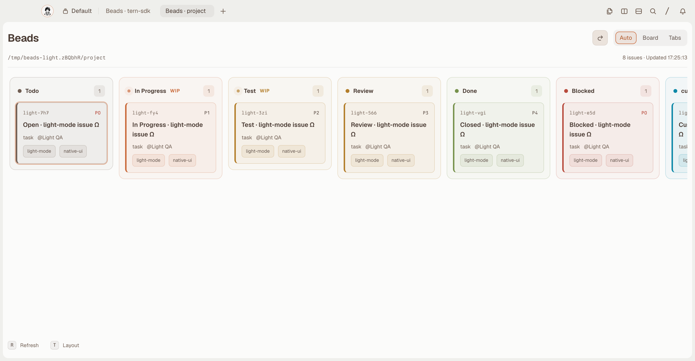
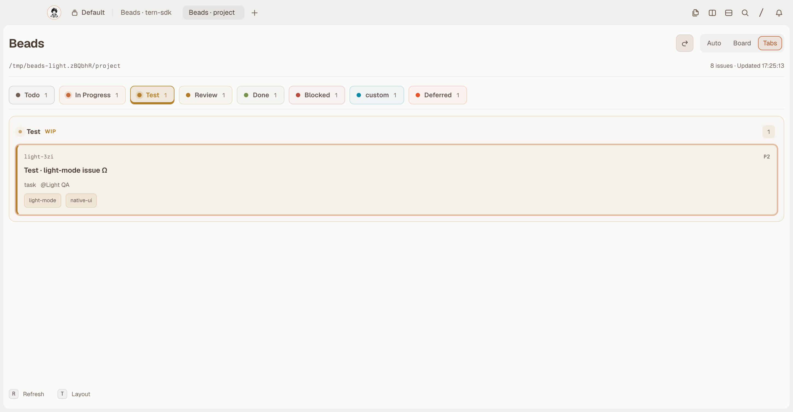
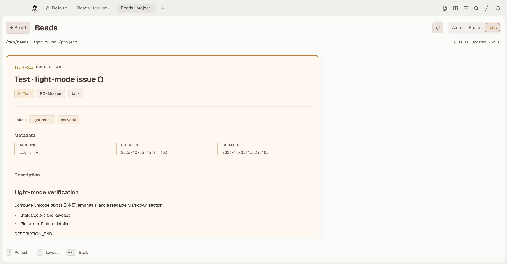
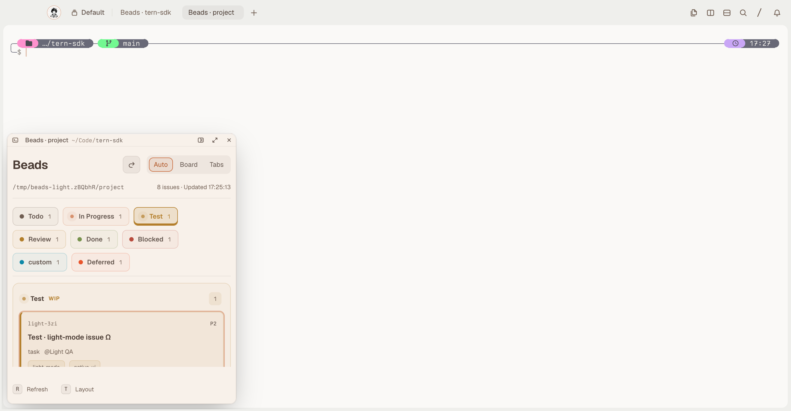
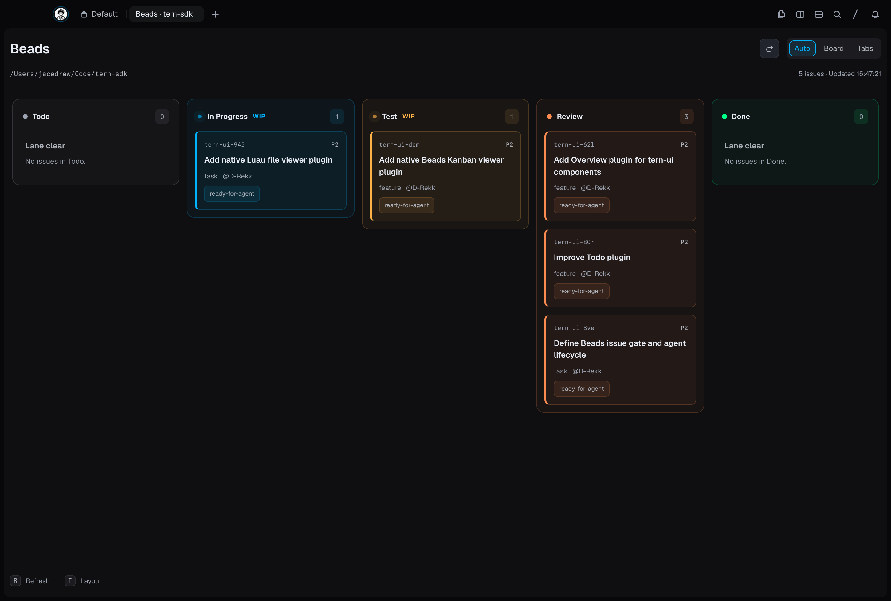
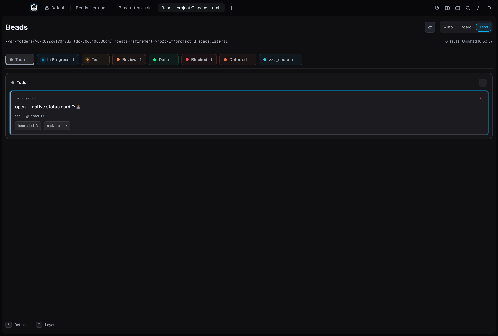
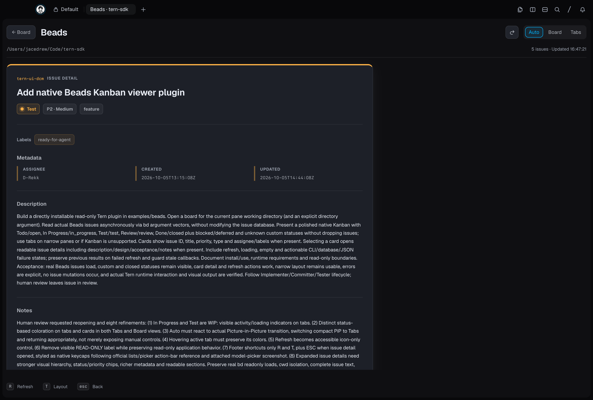
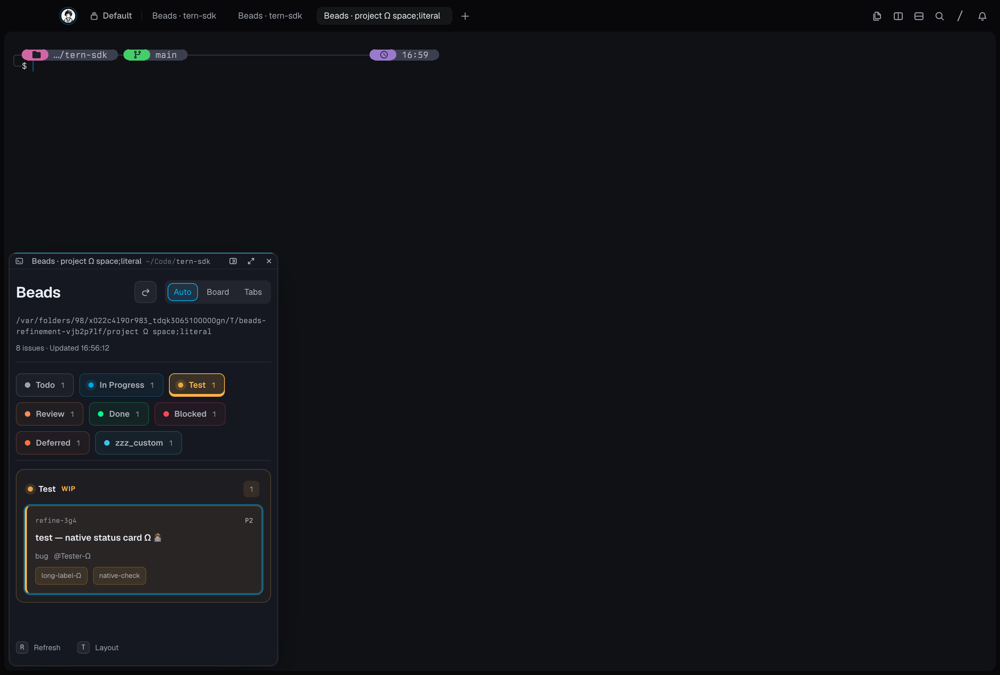

# Beads 1.0.0 historical screenshot gallery

[Back to the plugin README](../README.md)

Eight unmodified captures from native Beads plugin verification in Tern 0.4.5
(1d14241), with Beads CLI 1.3.0—not browser-rendered `tern serve` fixtures.
Datasets and viewport sizes vary: the Light captures use a 1450×754 viewport,
and the Dark captures use 1450×980 (both at 2× pixel density). These document observed
runtime views, not matched pixel comparisons or golden images.

These captures show Beads **1.0.0**, not the current **1.0.1** chrome. Version
1.0.1 adds explicit Open and ID-copy buttons, a sticky toolbar and opaque
main-region footer, responsive Tabs cards, and status dots that pulse only
for populated In Progress/Test lanes. See the [current plugin README](../README.md#interaction)
for current interactions; the historical captures have not been recreated.

## Light

Light appearance with the **light-canyon** theme, using an isolated real Beads
fixture database. In this palette, Test and Review share the same amber accent.

### Board

Light / light-canyon: Board view with status-colored lanes and issue cards.

### Tabs

Light / light-canyon: compact status Tabs with active and hover styling.

### Issue

Light / light-canyon: expanded issue details with metadata and Markdown content.

### PiP

Light / light-canyon: compact native Picture-in-Picture (PiP) with Tabs.

## Dark

Dark appearance with the **Titanium** theme. Captures include repository issues
and an isolated Beads fixture.

### Board

Dark / Titanium: Board view showing repository issues.

### Tabs

Dark / Titanium: compact status Tabs.

### Issue

Dark / Titanium: expanded issue details in a wide native pane.

### PiP

Dark / Titanium: compact native Picture-in-Picture (PiP) with Tabs.
